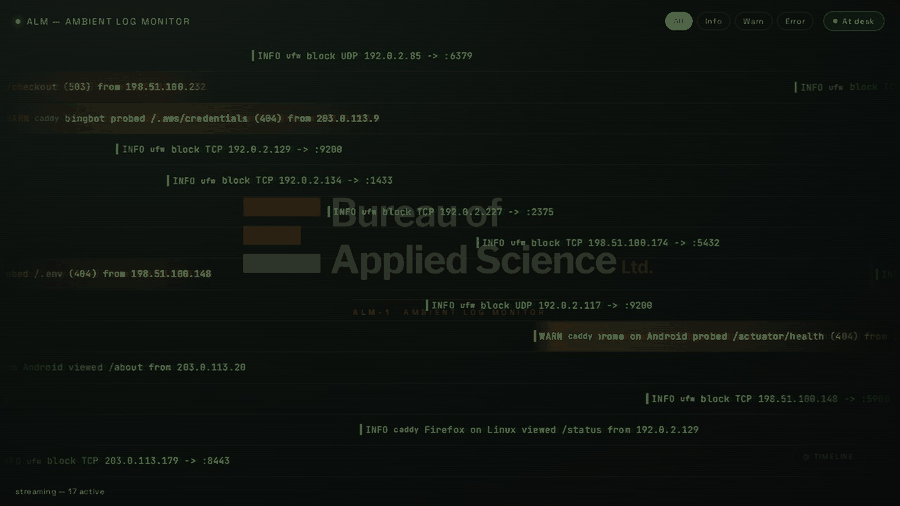
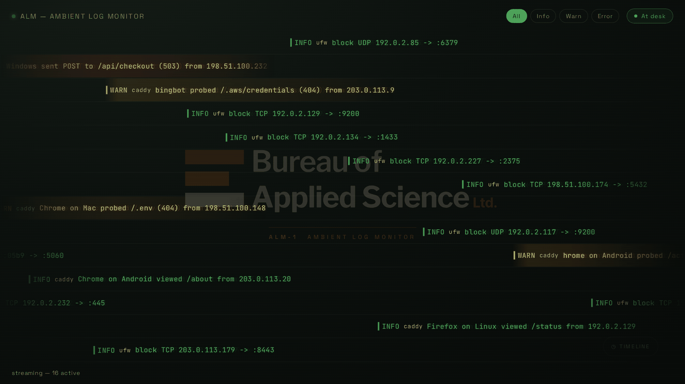
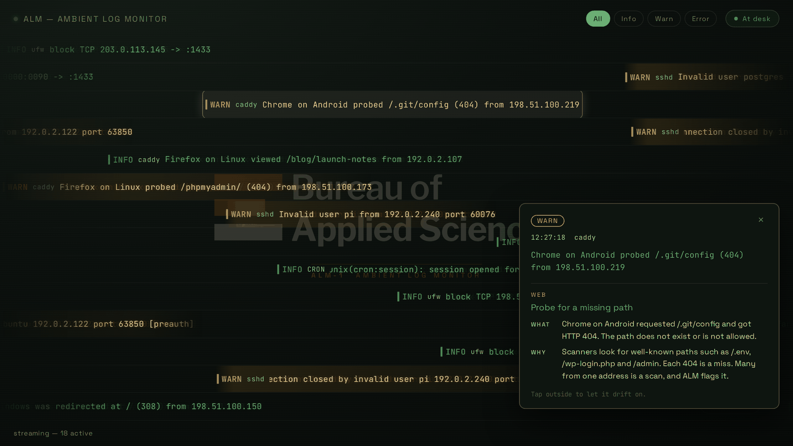
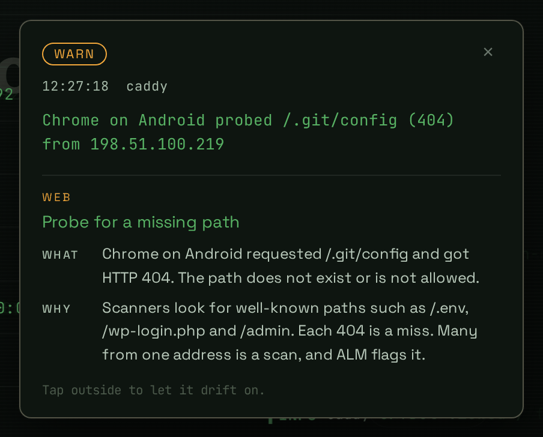
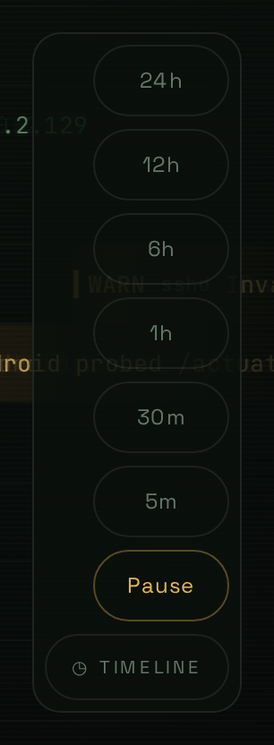
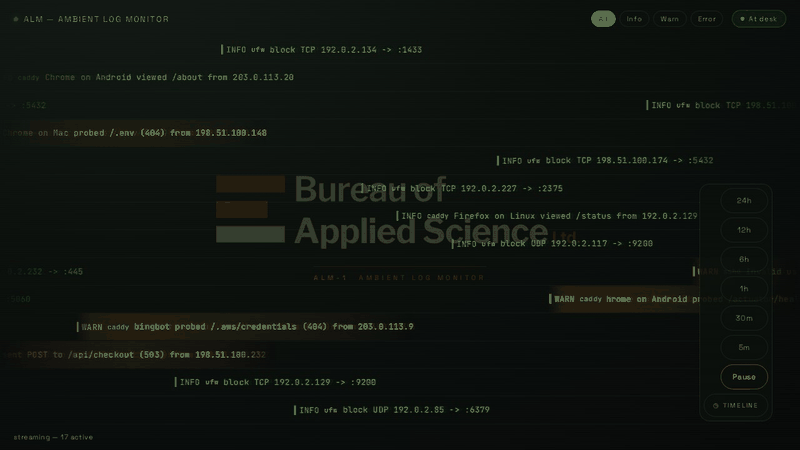
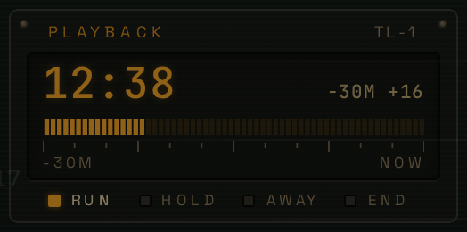
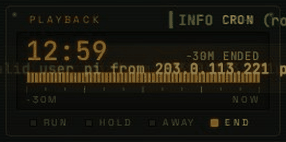

# ALM: ambient log monitor



Your logs, as ambient rain you can read. Entries drift right to left across a dedicated screen (a spare monitor, a tablet, a Chromebook screensaver) so a glance tells you whether your server is calm or under attack: a scanner hammering sshd, a ban landing, a deploy going sideways, a burst of 500s. Quiet traffic fades by; warnings and errors stand out. Touch one and it explains itself.

- **Glanceable.** Info drifts, warn glows amber, error burns orange-red. Floods are sampled, so the screen stays readable, and a repeat offender is raised as one loud entry instead of a thousand lines.
- **Self-explaining.** Tap any entry for what it is and why it is there, in plain language, from a shipped catalogue of about 200 kinds of log line.
- **Never misses a thing.** The record lives on your server. Close the laptop for the night, and the morning replay still has every event.
- **Replay on demand.** Play back the last 5 minutes to 24 hours as a short reel, with a little clock that glitches away at the end.
- **Small.** Python, one process, SQLite, one HTML file. Reads journald, log files, fail2ban and Caddy over ssh.

## Quick start

Needs Linux (or ChromeOS with Linux), Python 3.10+, and nothing else. No server required to try it:

```
git clone <this repo> alm && cd alm
./install.sh                                   # creates .venv and installs dependencies; changes nothing else
.venv/bin/python main.py --demo --web-only     # invented traffic plus a day of history; open http://localhost:8000/
```

`--demo` never reads or writes your real logs or history. Drop `--web-only` for the terminal view of the same thing. `./install.sh --check` diagnoses an install.

## A tour

**Watch.** Green is routine, amber is a warning, orange-red is an error. Entries enter on the right and leave on the left at a steady pace; the header filters by level.



**Inspect.** Tap an entry and it stops. The panel says what kind of line it is and why it is there, with this entry's address and path filled in. Tap outside or press Escape to let it drift on.





**Replay.** The faint `TIMELINE` toggle at the lower right opens window keys (5m, 30m, 1h, 6h, 12h, 24h) and Pause. A window plays back as a digest, errors first, with amber `REPLAY` tags on every entry. Pause holds the screen; resume catches you up on everything that arrived.





The playback clock shows when each entry actually happened, how far through the window it is, and how many entries the digest skipped.



When the last replayed entry has drifted off, the clock breaks up and is gone:



All of this media is generated from the demo data by `tools/screenshots.py` (see "Regenerating the media" below), so nothing in it is a real address.

## Watch something real

| You want | Run |
|---|---|
| This machine's journal | `.venv/bin/python main.py --web-only --journal` |
| Some log files | `.venv/bin/python main.py --web-only --tail /var/log/app.log --tail /var/log/other.log` |
| A server (recommended) | install the collector on it, then point ALM at it, below |
| A server, no install on it | `.venv/bin/python main.py --web-only --ssh myserver` (journal and fail2ban over ssh) |

### A server, with the collector

The collector is a small stdlib-only Python daemon that runs on the server, keeps the record there and raises burst alerts, so your screen can sleep, restart or be a new machine and still show everything it missed. Your screen is only a viewer.

```
ssh-copy-id myserver                            # key auth is required; ALM never prompts for a password
deploy/install-collector.sh myserver --dry-run  # see what it will detect and install
deploy/install-collector.sh myserver            # installs a user service on the server (undo with --remove)
./install.sh --service --collector myserver     # run ALM here as a service that syncs from it
./install.sh --check                            # confirms the chain: ssh, collector, web page
```

The collector finds `/var/log/fail2ban.log` and Caddy's logs by itself; pass `--file PATH:PARSER[:sudo]` for others (parsers `caddy`, `fail2ban`, `plain`; `:sudo` reads a root-only file through `sudo -n tail`). The server needs Python 3.10+ and `loginctl enable-linger` for its user.

### Settings

The service reads `~/.config/alm/alm.env` (created from `deploy/alm.env.example`, mode 600, never overwritten):

```
ALM_COLLECTOR=myserver        # ssh alias of the server running the collector
ALM_ARGS=--journal            # extra main.py flags for sources that need no collector
ALM_TOKEN=change-me           # required if you listen beyond localhost
```

Hosts and secrets live only there, not in the unit file or the repo. Restart after editing: `systemctl --user restart alm`.

### Watching a remote server directly over ssh

Without a collector the engine runs here and follows the remote machine through `ssh` (key auth only, `BatchMode`). It resumes from a stored cursor after every drop, sleep or restart, and shows an `alm` warn while the link is down. The server rate-limiting new logins is why all ssh to a host shares one connection.

```
.venv/bin/python main.py --ssh myserver
.venv/bin/python main.py --ssh myserver --ssh-file myserver:/var/log/caddy/access.log:caddy:sudo
```

- `--ssh HOST` follows the remote journal (sshd, kernel firewall, services) plus `/var/log/fail2ban.log`. Needs a user in `adm` or `systemd-journal`.
- Firewall blocks come from the journal as `ufw  block TCP 1.2.3.4 -> :5432` (info). sshd probing (invalid users, failed passwords, bad negotiations) is raised to warn. fail2ban shows `found` (warn) and `ban` (error).
- `--ssh-file HOST:PATH:PARSER[:sudo]` follows one file; parsers are `caddy` (5xx error, 4xx warn), `fail2ban`, `plain`. Add `sudo` only for files your user cannot read; it runs `sudo -n tail`, so it needs passwordless sudo. Giving the user the file's group is the tighter alternative.
- Paths with `:` are not supported in the spec.

Demo: `python3 tools/fake_log.py /tmp/alm.log` in one terminal, `main.py --tail /tmp/alm.log` in another.
Log line formats for `--tail`: JSON with `level/source/message`, or `[HH:MM:SS] LEVEL source message`; anything else shows as info.
Info/debug lines are rate-limited (`INFO_PER_SEC` in `rain_engine.py`); warn and error always pass.

`http://host:8000/?screensaver=1` is the screensaver mode: no header, cursor hides when idle, streams stay interactive. Leave with an inward swipe from any screen edge (24 px zone, 64 px travel) or Escape. `?token=` carries the secret.

## Timeline

Explore history in order: window buttons **5m, 30m, 1h, 6h, 12h, 24h** play the last window back as a catch-up reel, entries entering at the minute the little clock shows. Playback is a digest, not a transcript: a per-second budget is spent errors first, then warns, then info, and the clock shows how many entries were skipped (`+37`). Live entries are hidden while it plays; live warn/error are banked ("N live since", click to return to live and replay them). Returning from away mode plays "warn/error since you left" the same way.

- Browser (normal and screensaver): a faint `TIMELINE` toggle at the lower right, within right-thumb reach. Tap it for the window keys (5m to 24h, plus Pause and Live while playing); it folds away after a window is chosen or 6 s idle. The first key there, **Pause** (or Space), holds the live screen; resume catches you up: after a pause of 5 s or more it replays everything that arrived, with the clock counting down to live (`LIVE IN 0:12`), and the clock then glitches away. A shorter pause just replays what warned.
- TUI: `t` cycles live, 5m ... 24h, live; `p` pause/resume; `x` back to live.
- History is a SQLite file, `~/.local/share/alm/history.db` (`--db`), kept 7 days (`--keep-days`). Each source syncs by a stored cursor on every start and reconnect, so sleep or a restart leaves no hole; the very first run loads `--backfill HOURS` (default 24, 0 = from now). `--no-history` turns it all off. Only real sources are stored, never mock data.

## Desk events

While the screensaver is up, ALM records when it opened, the first input after a quiet spell (`input after 2.1h quiet (touch)`), and how it was dismissed (`dismissed by edge swipe from right (touch)`). They go to history only: you see them in the **timeline playback** (source `desk`) and in the extension's **Recent activity** on its options page, never as live drops. It can tell you something touched the machine and when, not who.

## Controls in short
Tap the faint `TIMELINE` toggle at the lower right: window keys (5m to 24h), **Pause** (also Space) and **Live**. Tap a stream to inspect it: the panel says what the entry is and why it is there. Tap outside, press Escape or the x to let it drift on.

## Status

Built: engine, TUI, web, ingestion (files, journald, ssh), burst detector, systemd service, on/off switch in the extension toolbar, vignette beneath the text, interactive screensaver (exit by inward edge swipe or Escape), extension that stays up while you use it, history store with backfill, timeline in browser, screensaver and TUI. Open items are in `TODO.md`; the spec is `DESIGN.md`. Added 2026-10-30: a Bureau of Applied Science nameplate, new green/amber palette, clock as a playback module that lingers and glitches away, lower-right timeline toggle, pause for live and timeline, catch-up replay with a countdown, explanations in the inspect view, tidier Caddy lines, history row cap.

## Chromebook screensaver

ChromeOS has no API to replace its built-in screensaver, so the extension opens a fullscreen ALM window when the device goes idle and holds the display awake (`chrome.power`) until you return.

1. Easiest: run ALM in the Chromebook's Linux container as a service (`./install.sh --service --collector myserver`), with the collector on your server keeping the record, so a sleeping Chromebook misses nothing. Alternatively run the engine on an always-on host, bound to loopback.
2. Crostini forwards the container's port 8000 to ChromeOS `localhost`, so nothing else is needed. If the engine runs on another host: `ssh -N -L 8000:127.0.0.1:8000 you@host`.
3. In ChromeOS Chrome: `chrome://extensions`, Developer mode, Load unpacked, and pick `extension/` from "Linux files" (code > alm > extension). If the picker cannot read it, copy the folder into "My files" first. Unverified which is needed.
4. After pulling changes, reload the extension (`chrome://extensions`, the circular arrow on its card); Chrome does not do it for you. The options page title shows the version (v0.2.0 or later closes only on an edge swipe, Escape or lock; v0.1.x closed on any touch).
5. If the saver closes when it should not, open the options page and read **Recent activity** (v0.3.0+). Every open and close is logged with its reason: `closed by us: page asked {edge-swipe ...}` (a touch landed in an edge zone; coordinates, viewport and pixel ratio are included), `page asked {escape}`, `screen locked`, or `closed EXTERNALLY` (the OS or something else closed the window). Page-side breadcrumbs (`page: pointerdown`, `pagehide`, `blur`, `fullscreenchange`) precede it.
6. To switch it off while you watch something: click the ALM toolbar button (pin it from the puzzle-piece menu). A grey `off` badge shows it is disabled, and a saver that is already up closes. Click again to turn it back on. The **Enabled** checkbox on the options page does the same and applies at once. (v0.4.0+)
7. Open the extension's options: set the ALM address (and token), the idle timeout, Save, then Test now.
8. v0.4.1 was loaded unpacked and tested on 2026-10-30. The rows in the checklist below are not individually confirmed. Two copies of the extension both open a saver on idle, so keep only one card at `chrome://extensions`. Settings live in `chrome.storage.sync` per extension ID, so a copy loaded from a different path has a new ID and starts with empty settings. Nothing in the page or the engine hard-codes the ID (the saver URL carries `&ext=<id>`).

### Checklist only the Chromebook can answer
| Check | Expected | If not |
|---|---|---|
| Options page shows an auto-lock delay | greater than your saver timeout | lower the timeout or raise auto-lock, else the lock screen wins and the saver never shows |
| Wait out the idle timeout | saver window goes fullscreen | check chrome://extensions service worker log |
| Screen stays on while the saver runs | no dim, no lock | `requestKeepAwake` may be blocked by admin policy |
| Swipe inward from a screen edge (or Escape) | saver closes | ChromeOS may claim edge swipes for its own gestures; tell me which edges |
| Move the mouse, click a drop | saver stays, drop is caught | |
| Lid closed with external monitor | still running | Settings > Device > Power: disable sleep on lid close |
| Stop the tunnel | "alm offline, retrying", recovers on its own | |

## Tests

```
./install.sh --dev && .venv/bin/playwright install chromium
.venv/bin/pytest
```
Engine (fake clock), parsers, a real browser against a real server, and the extension loaded into real Chromium. Real `chrome.idle` transitions are simulated through the extension's message hook.

## Regenerating the media

The pictures and GIFs at the top of this file come from `tools/screenshots.py`, so they can be redone after any UI change with one command and cannot leak anything real:

```
./install.sh --dev && .venv/bin/playwright install chromium     # once
.venv/bin/python tools/screenshots.py                           # about four minutes, writes docs/img/
.venv/bin/python tools/screenshots.py --only hero,detail        # just some of them (hero, detail, replay)
```

It starts `main.py --demo` (invented data from `demo.py`, seeded so every run looks the same) in memory, drives it with headless Chromium, and checks the page text before every capture: any IP address outside the documentation ranges, or a name on its denylist, aborts the run. Look at the images before committing them. To change what the demo shows, edit the scenarios in `demo.py` (a day of baseline noise plus three incidents); to add a capture, add a step to `main_async` in `tools/screenshots.py`. The replay is recorded in real time, which is why the run is slow.

## Layout
`rain_engine.py` state and lifecycle, `demo.py` invented data for `--demo` and the media, `tools/screenshots.py` the media generator, `rain_web.py` FastAPI and WebSocket, `rain_tui.py` terminal client, `web/index.html` browser client, `tail.py` file and journald sources, `extension/` Chromebook saver, `alm_collector.py` the collector that runs on the watched host, `install.sh` and `deploy/` (service units, settings example, collector installer), `tools/doctor.py` the diagnostics.
